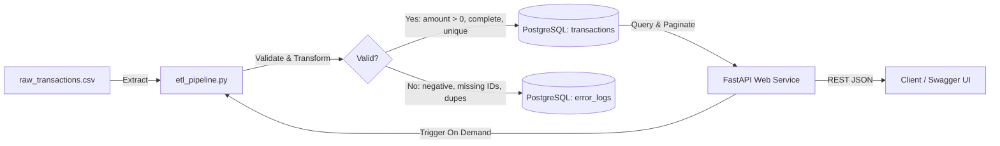

# FinFlow Processor

[](https://fastapi.tiangolo.com)
[](https://www.postgresql.org)
[](https://docs.docker.com/compose/)
[](https://www.python.org/)
[](https://docs.pytest.org)

**FinFlow Processor** is a high-performance financial data ingestion, ETL, and analytics service. Built on **FastAPI**, **SQLAlchemy**, and **PostgreSQL**, it extracts raw financial transactions, enforces business validation rules, archives corrupt records into an audit log, and serves paginated query and trigger endpoints via REST APIs.

---

## 📋 Table of Contents

- [System Architecture](#-system-architecture)
- [Directory Structure](#-directory-structure)
- [Prerequisites](#-prerequisites)
- [Quick Start with Docker Compose](#-quick-start-with-docker-compose)
- [REST API Endpoints](#-rest-api-endpoints)
- [ETL Pipeline & Data Validation](#-etl-pipeline--data-validation)
- [Running Automated Tests](#-running-automated-tests)
- [Docker Management & Monitoring](#-docker-management--monitoring)
- [Local Development Setup](#-local-development-setup)

---

## 🏛 System Architecture



---

## 📁 Directory Structure

```text
finflow-processor/
├── app/
│   ├── __init__.py
│   ├── main.py                     # FastAPI application setup & routes
│   ├── api/
│   │   ├── __init__.py
│   │   └── v1/
│   │       ├── __init__.py
│   │       ├── router.py           # API v1 route aggregator
│   │       └── endpoints/
│   │           ├── __init__.py
│   │           ├── health.py       # Health check & database probe
│   │           └── transactions.py # Transaction CRUD & analytics
│   ├── core/
│   │   ├── __init__.py
│   │   ├── config.py               # Environment configuration & settings
│   │   └── database.py             # SQLAlchemy engine & session maker
│   ├── models/
│   │   ├── __init__.py
│   │   └── transaction.py          # SQLAlchemy ORM models (Transaction & ErrorLog)
│   ├── schemas/
│   │   ├── __init__.py
│   │   ├── health.py               # Pydantic health schemas
│   │   └── transaction.py          # Pydantic transaction & error schemas
│   └── services/
│       ├── __init__.py
│       └── processor.py            # Analytics and calculation engine using Pandas
├── tests/
│   ├── __init__.py
│   ├── conftest.py                 # Pytest fixtures and isolated SQLite test DB
│   └── test_main.py                # Unit & integration tests
├── .env                            # Active environment configuration
├── .env.example                    # Environment variable template
├── .gitignore                      # Git ignore rules
├── Dockerfile                      # Application container specification
├── docker-compose.yml              # Multi-container orchestration (FastAPI + PostgreSQL)
├── etl_pipeline.py                 # Core ETL service script
├── generate_mock_data.py           # Synthetic financial data generator
├── main.py                         # Root entry point for FastAPI
├── models.py                       # Root models module re-exporting ORM models
├── raw_transactions.csv            # Mock transaction data file
├── requirements.txt                # Python dependencies
└── test_main.py                    # Root test runner module
```

---

## ⚙️ Prerequisites

- **[Docker Desktop](https://www.docker.com/products/docker-desktop/)** (v20.10+ / Compose v2.0+)
- **[Python](https://www.python.org/)** (v3.11+) if running outside Docker

---

## 🐳 Quick Start with Docker Compose

Running the entire stack with Docker Compose takes one command. This builds the FastAPI application container, starts the PostgreSQL database, applies schema migrations, and sets up health checks.

### 1. Start the Containers

From the project root:

```bash
docker compose up --build -d
```

> **Flags:**
> - `--build`: Rebuilds the image if code or dependencies have changed.
> - `-d`: Runs the containers in detached (background) mode.

### 2. Verify Services Are Healthy

Check container status:

```bash
docker compose ps
```

Expected output:
```text
NAME                    IMAGE                  COMMAND                  SERVICE   STATUS                    PORTS
finflow-db              postgres:16-alpine     "docker-entrypoint.s…"   db        Up (healthy)              0.0.0.0:5432->5432/tcp
finflow-processor-app   finflowprocessor-app   "uvicorn app.main:ap…"   app       Up                        0.0.0.0:8000->8000/tcp
```

### 3. Access the APIs & Interactive Documentation

Once containers are running:
- **Interactive Swagger Docs**: [http://localhost:8000/docs](http://localhost:8000/docs)
- **ReDoc Documentation**: [http://localhost:8000/redoc](http://localhost:8000/redoc)
- **Health Check Endpoint**: [http://localhost:8000/health](http://localhost:8000/health)
- **PostgreSQL Database**: `localhost:5432`

---

## 🌐 REST API Endpoints

### 1. Health Check
```http
GET /health
```
**Response (`200 OK`):**
```json
{
  "status": "healthy"
}
```

---

### 2. Paginated Transactions with Filters
```http
GET /transactions?skip=0&limit=50&status=SUCCESS&merchant=Amazon
```

**Query Parameters:**
| Parameter | Type | Default | Description |
| :--- | :--- | :--- | :--- |
| `skip` | `int` | `0` | Number of items to skip (offset) |
| `limit` | `int` | `100` | Number of items to return (max `1000`) |
| `page` | `int` | `None` | Optional 1-based page index (e.g. `page=2`) |
| `status` | `string` | `None` | Filter by transaction status (`SUCCESS` or `FAILED`) |
| `merchant` | `string` | `None` | Filter by merchant name (e.g. `Amazon`, `Target`) |

**Response (`200 OK`):**
```json
[
  {
    "id": 1,
    "transaction_id": "TXN246170",
    "account_number": "ACC959607",
    "amount": 4438.15,
    "currency": "USD",
    "merchant": "Amazon",
    "status": "SUCCESS",
    "timestamp": "2026-09-09T03:04:34.647883"
  }
]
```

---

### 3. Trigger ETL Pipeline On Demand
```http
POST /transactions/run-etl
```

Executes [`etl_pipeline.py`](file:///c:/Users/amrut/Desktop/Antigravity/FinFlow%20Processor/etl_pipeline.py) on demand and ingests raw transaction data.

**Response (`200 OK`):**
```json
{
  "status": "success",
  "message": "ETL pipeline executed successfully",
  "total_processed": 500,
  "total_successful": 495,
  "total_failed": 5
}
```

---

### 4. Summary Metrics
```http
GET /api/v1/transactions/summary
```
Returns volume, count, and breakdown by merchant calculated via Pandas.

---

## 🔄 ETL Pipeline & Data Validation

The ingestion engine in [`etl_pipeline.py`](file:///c:/Users/amrut/Desktop/Antigravity/FinFlow%20Processor/etl_pipeline.py) processes `raw_transactions.csv` through three phases:

1. **Extract**: Reads the CSV file using Pandas.
2. **Transform & Validate**:
   - **Amount Validation**: Enforces `amount > 0`. Catches negative, zero, and malformed numeric values.
   - **Mandatory Fields**: Catches missing or `null` values for `transaction_id`, `account_number`, `timestamp`, and `merchant`.
   - **Duplicate Detection**: Flags duplicates within the incoming CSV batch and checks against existing IDs in PostgreSQL.
   - **Timestamp Parsing**: Validates ISO-8601 timestamps.
3. **Load**:
   - Valid records are loaded into the `transactions` table.
   - Invalid records and the exact error reasons are stored in the `error_logs` table.

### Generating Mock Data & Running the Pipeline Manually

```bash
# 1. Generate 500 rows with 5 intentionally bad test rows
python generate_mock_data.py

# 2. Run ETL pipeline locally or inside Docker
python etl_pipeline.py
# OR inside container:
docker exec finflow-processor-app python etl_pipeline.py
```

---

## 🧪 Running Automated Tests

The test suite uses **pytest** with an isolated in-memory SQLite database, verifying API responses, database persistence, and validation logic without external dependencies.

Run the test suite directly inside the Docker container:

```bash
docker exec finflow-processor-app pytest -v
```

Or run locally (with dependencies installed):

```bash
pytest -v
```

### Test Coverage Highlights
- ✅ **Health Check**: Verifies `/health` returns `200 OK` and `{"status": "healthy"}`.
- ✅ **Negative Amount Validation**: Verifies negative and zero amounts are caught and categorized as errors.
- ✅ **Missing ID Validation**: Verifies empty strings, `None`, and `NaN` values are caught and categorized as errors.
- ✅ **Mandatory Field & Duplicate Checks**: Verifies account numbers, timestamps, and duplicate detection.
- ✅ **Pagination & Filtering**: Tests `limit`, `skip`, `status=SUCCESS`, `status=FAILED`, and `merchant=Amazon`.
- ✅ **On-Demand ETL Trigger**: Tests `POST /transactions/run-etl` response and execution metrics.

---

## 🛠 Docker Management & Monitoring

| Action | Command |
| :--- | :--- |
| **Start stack (background)** | `docker compose up --build -d` |
| **View running containers** | `docker compose ps` |
| **Follow application logs** | `docker compose logs -f app` |
| **Follow database logs** | `docker compose logs -f db` |
| **Stop containers (preserve data)** | `docker compose stop` |
| **Stop and remove containers** | `docker compose down` |
| **Reset database (remove volume)** | `docker compose down -v` |
| **Open PostgreSQL shell inside container** | `docker exec -it finflow-db psql -U postgres -d finflow_db` |

---

## 💻 Local Development Setup

If you prefer running without Docker:

```bash
# 1. Clone or navigate to the repository
cd "FinFlow Processor"

# 2. Create and activate a virtual environment
python -m venv .venv
# Windows:
.\.venv\Scripts\activate
# Linux/macOS:
source .venv/bin/activate

# 3. Install requirements
pip install -r requirements.txt

# 4. Copy environment template and configure DATABASE_URL
cp .env.example .env

# 5. Start FastAPI application
uvicorn main:app --host 0.0.0.0 --port 8000 --reload
```
